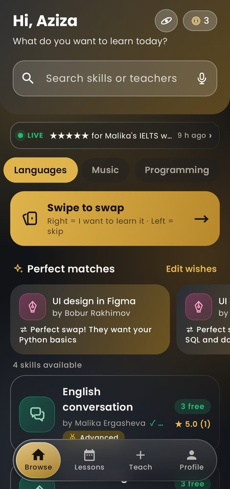
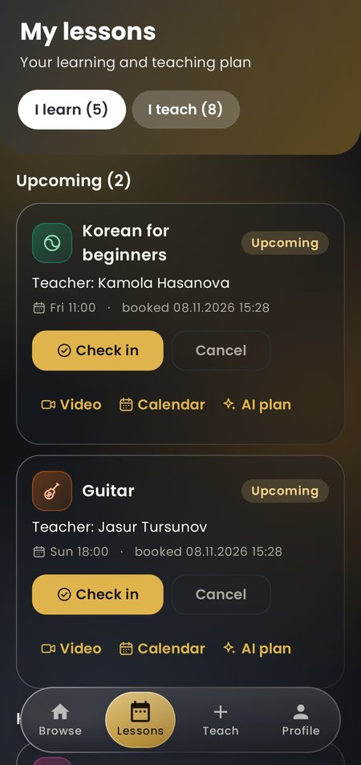
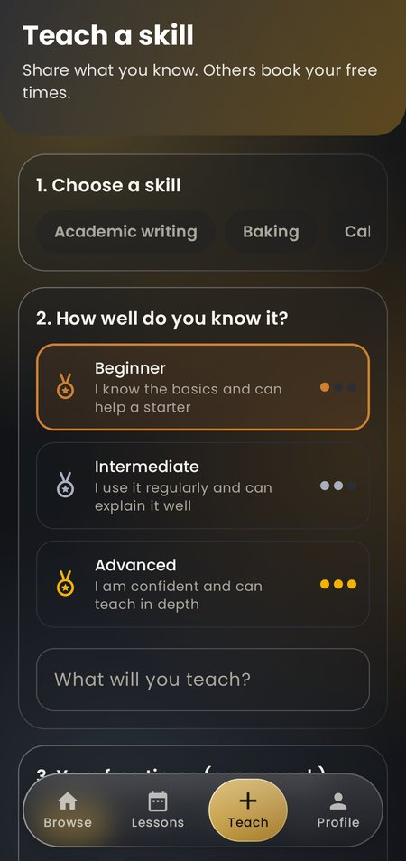
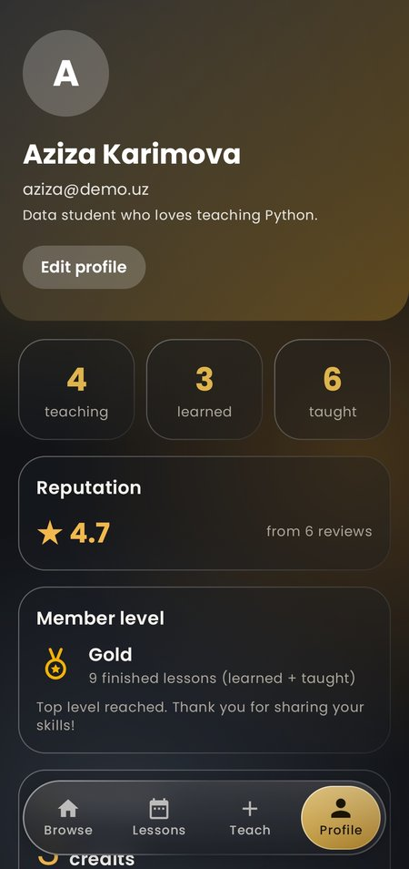

# SkillSwap (Android)

Trade skills, not bills. Students teach a skill they know and book lessons from other students, paid with time-bank credits.

Kotlin + Jetpack Compose (Material 3) + Room (local cache) + MVVM. The app is always online and shares its backend and database with the SkillSwap website ([skillswap](https://github.com/kubrobe/skillswap)).

## Screenshots

| Browse | My lessons | Teach a skill | Profile |
|---|---|---|---|
|  |  |  |  |

## Team

| Member | Group | Role |
|---|---|---|
| Abdullox Xojimurodov | I24B | Team leader, backend (server, database, API, live events, Telegram bot, server tests) |
| Biloliddin To'laganov | I24B | Design (brand, screens, icon set, motion, Skill Galaxy look, slides) |
| Najmiddin Kurganov | I24A | Android development (architecture, Room, network, screens, languages, unit tests, release APK) |

## Requirements

- Android Studio (recent version) with an emulator or a phone running **Android 7.0 (API 24) or newer**
- Internet connection (the app needs the server)

## Run

1. Android Studio -> File -> Open -> choose this folder (the one with `settings.gradle.kts`).
2. Wait for Gradle sync, then press the green Run button.
3. Log in with a demo account (below).
4. Unit tests (20): right-click `app/src/test/.../UtilsTest.kt` -> Run.
5. Release APK: Build -> Generate Signed App Bundle / APK -> APK -> release. Signing keys (`*.jks`, `keystore.properties`) are git-ignored and must never be committed.

**First start can be slow:** the server is on free hosting and goes to sleep when idle, so the first request after a quiet period can take up to a minute. If the app shows *No connection*, check the internet and press retry.

## Demo account

`aziza@demo.uz` / `demo12345` (others: `bobur@`, `dilnoza@`, `jasur@`, `nilufar@`, `kamola@`, `timur@demo.uz`, same password). The same accounts work on the website. All people and data are fictional.

## Screens (12)

Login, Register, Browse (search, categories, live ticker, perfect matches), Swipe to swap, Ask SkillSwap (voice), Offer detail (times and reviews), My lessons (I learn / I teach, check-in, cancel, rate), Teach (publish a listing), Profile (stats, level, time bank, badges, Telegram, language), Community impact, Skill Galaxy, Achievements.

## Features

- **Time bank:** teach 1 hour = +1 credit, learn 1 hour = -1. Wallet and history on Profile.
- **Perfect matches:** choose what you want to learn; people who teach it are shown, two-way swaps first.
- **Swipe to swap:** card deck; a two-way match shows "It's a swap!".
- **QR check-in:** the teacher shows a QR / 4-digit code and the learner scans it, so lessons cannot be faked (Trusted badge).
- **Live updates:** book on one phone and the teacher's phone shows a banner at once (server-sent events).
- **Voice AI matchmaker:** say what you want to learn and get the 3 best lessons with reasons (uses Claude when the server has an AI key, a keyword matcher otherwise).
- **AI lesson plan** for every lesson (template when no AI key), **video room** (Jitsi) and **add to calendar**.
- **Community impact** and **Skill Galaxy:** lessons, hours, weekly chart, estimated money saved (labelled as an estimate), and the community drawn as a solar system.
- **Badges and leaderboard:** 8 badges from real lessons, top teachers this week and all time.
- **Telegram bot:** booking alerts, a reminder 1 hour before each lesson, `/next`, `/credits`.
- **Languages:** English, Oʻzbekcha, Русский; the whole app switches at once.
- **Design:** Graphite & Gold theme, our own set of 68 line icons, glass cards, animated transitions; light and dark theme follow the phone. Animations follow the phone's animation-scale setting.

## Architecture

```
Screen (Compose) -> SkillSwapViewModel (StateFlow) -> SkillSwapRepository -> Room DAO -> SQLite (cache)
                                                                          \-> ApiClient (HTTPS) -> Express -> PostgreSQL
```

- The server (Express + PostgreSQL on Supabase) is shared with the website: `https://skillswap-vqt7.onrender.com/api/mobile`. API description: `docs/MOBILE_API.md` in the website repo.
- Login returns a session token; the app sends `Authorization: Bearer <token>`. The token is stored encrypted on the phone (AES-GCM, Android Keystore).
- `GET /sync` downloads everything; the app writes it into Room in **one transaction** (`SyncDao.replaceAll`). Screens read from Room, so they are instant and update by themselves.
- Changes (book, cancel, done, rate, publish, edit profile) go to the server first, then the app re-syncs.
- No extra networking libraries: `HttpURLConnection` + `org.json` (built into Android), calls run on `Dispatchers.IO`.
- The app contains **no database passwords or API keys**; the phone only talks to the server.

### Local cache (Room, 6 tables)

`users`, `skills`, `offers` (user -> skill), `time_slots` (-> offer), `bookings` (-> user, slot, offer), `reviews` (-> booking). The full database on the server has 24 tables (see the website repo).

### Business rules (checked on the server, inside PostgreSQL transactions)

- Booking: not your own lesson, the slot is still free (`SELECT ... FOR UPDATE`), you have a credit. All or nothing, so two phones can never book the same slot.
- Finishing a lesson needs the teacher's 4-digit check-in code (QR); the teacher then gets +1 credit.
- Cancelling frees the time and refunds the credit. Only a finished lesson can be rated, once.
- Passwords are hashed with bcrypt on the server.
